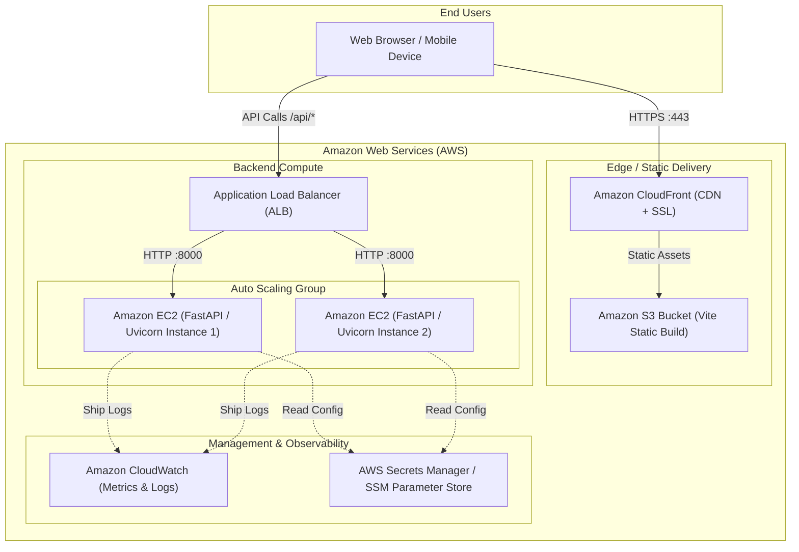

# 🌧️ AquaHarvest — Rainwater Harvesting Potential Calculator

> A full-stack, demonstration-ready hydrological calculation engine and decision-support web application for estimating rooftop rainwater collection potential, storage sizing, water cost savings, and UN Sustainable Development Goal (SDG) impacts.

---

## 📌 1. Project Overview & Problem Statement

Freshwater scarcity, groundwater depletion, and climate change are intensifying pressure on municipal water utilities and natural aquifers worldwide. Rapid urban development replaces natural permeable landscapes with impermeable rooftops and paved surfaces, causing massive stormwater runoff surges that overwhelm drainage networks and trigger urban flooding.

**Rainwater Harvesting (RWH)** presents an accessible, decentralized solution that captures precipitation directly at the source. However, homeowners, students, building designers, and institutional facility managers often lack transparent, accessible tools to:
- Quantify exact volume yields based on catchment materials and local precipitation patterns.
- Properly size storage tanks to avoid prohibitive capital expenditure or chronic rainy-season overflow.
- Estimate financial savings from reduced reliance on commercial tankers and municipal water tariffs.
- Demonstrate tangible contributions to local flood mitigation and global sustainability targets.

**AquaHarvest** addresses this gap with a modern, scientifically grounded calculator that transforms catchment area and rainfall parameters into actionable hydrological insights, storage recommendations, and printable audit reports.

---

## 🎯 2. Objectives & Target Users

### Objectives
1. **Accurate Hydrological Modeling**: Calculate gross and net collectable rainwater volume across annual, monthly, and wet-day periods.
2. **Storage Sizing Optimization**: Deliver transparent storage cistern recommendations balancing dry-spell buffer against capital investment.
3. **Economic & Ecological Valuation**: Compute annual financial tariff savings and quantify carbon offset metrics from avoided pumping.
4. **Demonstrable SDG Alignment**: Track contributions towards **UN SDGs 6, 11, and 12**.
5. **Auditable Decision Support**: Enable seamless report export to CSV and printable PDF for project submissions and architectural audits.

### Target Users
- **Students & Academic Researchers**: Exploring green engineering, hydrology, and sustainability.
- **Homeowners & Residential Societies**: Seeking to reduce monthly water utility bills and achieve water autonomy.
- **Campus & Institutional Planners**: Designing decentralized rainwater systems for universities, schools, and hospitals.
- **Commercial & Industrial Facility Managers**: Assessing catchment potential for large warehouse roofs.

---

## 🚀 3. Features

- **Dynamic Hydrological Engine**: Implements the fundamental principle where 1 mm of rain across 1 m² of roof catchment yields exactly 1 Litre of gross water.
- **Multi-Scenario Pre-sets**: One-click quick loading of realistic pre-calibrated scenarios:
  - *Urban Residential Home* (150 m², 950 mm rainfall, 85% efficiency)
  - *Campus Academic Block* (1,200 m², 800 mm rainfall, 80% efficiency)
  - *Commercial Warehouse* (3,500 m², 1,100 mm rainfall, 90% efficiency)
- **Granular 12-Month Rainfall Analysis**: Supports uniform average distribution estimation or full 12-month discrete rainfall input.
- **Mass-Balance Storage Overflow Simulation**: Models monthly inflow, storage accumulation, consumption, and overflow when a storage tank capacity is specified.
- **Demand Offset Calculation**: Computes the percentage of facility water demand fulfilled by harvested precipitation.
- **Interactive Recharts Visualizations**:
  - Combined bar/line chart for monthly precipitation and harvested yield.
  - Donut chart comparing harvested rainwater versus runoff/absorption losses.
- **Carbon & Flood Mitigation Metrics**: Calculates avoided municipal energy emissions (kg CO₂e) and stormwater surge mitigated.
- **Comprehensive Audit Report Export**:
  - One-click structured **CSV data download**.
  - Professional, print-ready **PDF report** via styled browser print dialog (`window.print()`).
- **Full Backend API Documentation**: Interactive Swagger (`/docs`) and ReDoc (`/redoc`) powered by FastAPI.

---

## 🛠️ 4. Technology Stack

| Layer | Technologies | Description |
|---|---|---|
| **Backend** | Python 3.10+, FastAPI, Pydantic v2, Uvicorn | High-performance async REST API with type validation |
| **Testing** | pytest, pytest-cov, Starlette TestClient, httpx | Automated test suite covering math, edge cases, and API routes |
| **Frontend** | React 18, Vite 5, JavaScript (ES Modules) | Ultra-fast client-side single page application |
| **Data Visualization** | Recharts | Composed monthly charts and proportional donut visualizations |
| **Icons & Styling** | Lucide React, Modern Vanilla CSS | Accessible, responsive, environmental green/ocean design |
| **Deployment / Cloud** | AWS S3, CloudFront, EC2 / App Runner | Cloud-ready static frontend + containerized backend architecture |

---

## 📐 5. Rainwater Calculation Formula & Assumptions

### Fundamental Formula
$$\text{Harvested Water (Litres)} = \text{Roof Area } (m^2) \times \text{Rainfall } (mm) \times \text{Collection Efficiency}$$

### Mathematical Basis
- $1\text{ mm} = 0.001\text{ m}$ of precipitation depth.
- Across $1\text{ m}^2$ of catchment:
  $$\text{Volume} = 0.001\text{ m} \times 1\text{ m}^2 = 0.001\text{ m}^3$$
- Since $1\text{ m}^3 = 1,000\text{ Litres}$, it follows that:
  $$1\text{ mm of rainfall over } 1\text{ m}^2 \equiv 1.0\text{ Litre of water}$$

### Collection Efficiency (Runoff Coefficient)
Accounts for surface texture absorption, wind-driven losses, evaporation, and first-flush diversion:
- **Galvanized Iron / Metal Sheeting**: $90\% - 95\%$
- **Concrete Roof Slabs / Glazed Tiles**: $80\% - 85\%$
- **Paved / Gravel Catchments**: $70\% - 75\%$

### Storage Tank Recommendation Heuristic
1. **Demand-Driven Basis (when daily demand is specified)**:
   $$\text{Recommended Capacity} = \text{Daily Demand (L/day)} \times 25\text{ days}$$
   Provides ~3.5 weeks of dry-spell buffering for non-potable uses.
2. **Yield-Driven Basis (default)**:
   $$\text{Recommended Capacity} = \max(1,000\text{ L}, \text{Annual Harvested Litres} \times 0.10)$$
   Sizes the cistern to retain approximately 10% of annual harvest (~36.5 days of average production).

### Financial Savings Formula
$$\text{Financial Savings (\$)} = \text{Annual Harvested Volume } (m^3) \times \text{Tariff Rate } (\$/m^3)$$

---

## 📂 6. Folder Structure

```
Cloud_ABA/
├── backend/
│   ├── app/
│   │   ├── __init__.py
│   │   ├── main.py                  # FastAPI application entry & CORS
│   │   ├── models/
│   │   │   ├── __init__.py
│   │   │   └── schemas.py           # Pydantic request & response schemas
│   │   ├── routes/
│   │   │   ├── __init__.py
│   │   │   └── calculator.py        # /api/calculate, /health, /scenarios
│   │   └── services/
│   │       ├── __init__.py
│   │       └── calculator.py        # Hydrological calculation engine
│   ├── tests/
│   │   ├── __init__.py
│   │   ├── test_api.py              # API endpoint and validation tests
│   │   └── test_calculator.py       # Core mathematical and logic tests
│   ├── conftest.py                  # Pytest configuration adding root to sys.path
│   └── requirements.txt             # Backend Python dependencies
├── frontend/
│   ├── public/
│   ├── src/
│   │   ├── components/
│   │   │   ├── EnvironmentalImpactCard.jsx
│   │   │   ├── ExportReportModal.jsx
│   │   │   ├── GrossVsCollectableChart.jsx
│   │   │   ├── InputForm.jsx
│   │   │   ├── MonthlyChart.jsx
│   │   │   ├── Navbar.jsx
│   │   │   ├── ResultsDashboard.jsx
│   │   │   ├── ResultsTable.jsx
│   │   │   └── StorageAnalysisCard.jsx
│   │   ├── services/
│   │   │   └── api.js               # Frontend API client
│   │   ├── App.jsx                  # Main dashboard controller
│   │   ├── index.css                # Custom environmental theme & print styles
│   │   └── main.jsx                 # React root mount
│   ├── index.html                   # HTML entry point
│   ├── package.json                 # Frontend dependencies & build scripts
│   └── vite.config.js               # Vite config with API proxy
├── .env.example                     # Environment template
├── .gitignore                       # Git ignore rules
└── README.md                        # Documentation
```

---

## ⚡ 7. Prerequisites & Local Setup Instructions

### Prerequisites
- **Python 3.10+**
- **Node.js 18+** & **npm 9+**

### Step 1: Clone or Navigate to the Project
```bash
cd /Users/shashankgowda/Downloads/Cloud_ABA
```

### Step 2: Backend Setup & Execution
1. Activate or create the Python virtual environment:
   ```bash
   cd backend
   python3 -m venv .venv
   source .venv/bin/activate
   ```
2. Install Python dependencies:
   ```bash
   pip install -r requirements.txt
   ```
3. Start the FastAPI backend server:
   ```bash
   uvicorn app.main:app --reload --host 0.0.0.0 --port 8000
   ```
   *The API will be live at `http://127.0.0.1:8000`. Swagger documentation is available at `http://127.0.0.1:8000/docs`.*

### Step 3: Frontend Setup & Execution
Open a second terminal window:
1. Navigate to the frontend directory:
   ```bash
   cd /Users/shashankgowda/Downloads/Cloud_ABA/frontend
   ```
2. Install dependencies:
   ```bash
   npm install
   ```
3. Start the Vite development server:
   ```bash
   npm run dev
   ```
   *The web application will open at `http://localhost:5173`.*

---

## 🧪 8. How to Run the Tests

The test suite validates:
- Fundamental rainwater equation accuracy.
- Zero rainfall and zero roof area edge cases.
- Variable collection efficiencies ($70\%$ to $95\%$).
- Monthly breakdown with discrete 12-month user inputs.
- Mass-balance storage overflow calculation.
- Daily wet-day harvest rates.
- Strict Pydantic input validation (rejection of negative numbers, invalid values with `422 Unprocessable Entity`).
- API endpoint status codes and schema structures.

Run the test suite using pytest inside the backend environment:
```bash
cd backend
source .venv/bin/activate
pytest -v
```

### Test Suite Output
```text
============================= test session starts ==============================
collected 20 items

tests/test_api.py::test_health_check_endpoint PASSED                     [  5%]
tests/test_api.py::test_root_endpoint PASSED                             [ 10%]
tests/test_api.py::test_calculate_endpoint_success PASSED                [ 15%]
tests/test_api.py::test_calculate_endpoint_with_custom_monthly_rainfall PASSED [ 20%]
tests/test_api.py::test_calculate_invalid_negative_roof_area PASSED      [ 25%]
tests/test_api.py::test_calculate_invalid_negative_rainfall PASSED       [ 30%]
tests/test_api.py::test_calculate_invalid_efficiency_out_of_bounds PASSED [ 35%]
tests/test_api.py::test_calculate_missing_required_fields PASSED         [ 40%]
tests/test_api.py::test_calculate_invalid_monthly_rainfall_length PASSED [ 45%]
tests/test_api.py::test_monthly_breakdown_endpoint PASSED                [ 50%]
tests/test_api.py::test_sample_scenarios_endpoint PASSED                 [ 55%]
tests/test_calculator.py::test_basic_rainfall_formula PASSED             [ 60%]
tests/test_calculator.py::test_zero_rainfall PASSED                      [ 65%]
tests/test_calculator.py::test_zero_roof_area PASSED                     [ 70%]
tests/test_calculator.py::test_different_collection_efficiencies PASSED  [ 75%]
tests/test_calculator.py::test_water_cost_savings_calculation PASSED     [ 80%]
tests/test_calculator.py::test_monthly_totals_with_explicit_monthly_rainfall PASSED [ 85%]
tests/test_calculator.py::test_storage_tank_recommendation_and_overflow PASSED [ 90%]
tests/test_calculator.py::test_daily_harvest_estimates PASSED            [ 95%]
tests/test_calculator.py::test_demand_offset_percentage PASSED           [100%]

======================== 20 passed in 0.19s =========================
```

---

## 📡 9. API Endpoints & Example Requests

### 1. Health Check
`GET /api/health`
```json
{
  "status": "healthy",
  "service": "Rainwater Harvesting Potential Calculator API",
  "version": "1.0.0"
}
```

### 2. Rainwater Calculation
`POST /api/calculate`

**Request Body:**
```json
{
  "roof_area": 150.0,
  "annual_rainfall": 950.0,
  "collection_efficiency": 85.0,
  "rainy_days": 75,
  "water_cost_per_m3": 2.85,
  "tank_capacity": 5000.0,
  "daily_water_demand": 350.0
}
```

**Response Body (Truncated Example):**
```json
{
  "gross_rainfall_litres": 142500.0,
  "collectable_litres": 121125.0,
  "collectable_m3": 121.125,
  "average_monthly_litres": 10093.75,
  "average_daily_litres": 331.85,
  "average_daily_rainy_day_litres": 1615.0,
  "estimated_financial_savings": 345.21,
  "water_cost_per_m3": 2.85,
  "demand_offset_percentage": 94.8,
  "storage_analysis": {
    "recommended_capacity_litres": 8750.0,
    "recommended_capacity_m3": 8.75,
    "recommendation_basis": "25 days of average water demand buffer (350 L/day × 25 days)",
    "user_tank_capacity_litres": 5000.0,
    "estimated_annual_overflow_litres": 14875.0,
    "storage_coverage_days": 14.3
  },
  "environmental_impact": {
    "co2_reduction_kg": 34.76,
    "stormwater_runoff_mitigated_litres": 121125.0,
    "sdg_alignment": [
      {
        "sdg": "SDG 6",
        "title": "Clean Water and Sanitation",
        "target": "Target 6.4: Substantially increase water-use efficiency...",
        "impact": "Harvests 121.1 m³ of clean rainwater annually..."
      }
    ]
  }
}
```

### 3. Preset Demo Scenarios
`GET /api/scenarios`
Returns pre-calibrated configurations for residential, campus, and industrial sites.

---

## 💻 10. How to Use the Application

1. **Load a Preset or Enter Custom Data**:
   - Click one of the three preset buttons (**Home**, **Campus**, or **Industrial**) to immediately load tested real-world scenario values.
   - Or enter custom roof dimensions, precipitation, and local water tariff rates.
2. **Review Key Results**:
   - Observe annual collectable volume in litres and cubic metres.
   - Inspect the **Monthly Harvest Profile** chart and **Gross vs. Collectable** donut chart.
3. **Simulate Tank Sizing & Overflow**:
   - Enter your planned or existing storage cistern capacity.
   - Inspect the **Storage Analysis Card** to verify whether overflow will occur during wet months and how many days of autonomous water supply the tank provides.
4. **Export Findings**:
   - Click **Export Audit Report** in the top right.
   - Download the structured CSV dataset or click **Print / Save to PDF** for a presentation-grade printed dossier.

---

## ☁️ 11. AWS Cloud Readiness & Deployment Guide

This application is designed with cloud-native principles and is prepared for AWS production deployment without altering local development behavior.

### Deployment Architecture Diagram



### Practical AWS Setup Steps

#### 1. Frontend Deployment (Amazon S3 + CloudFront)
1. Build the production bundle:
   ```bash
   cd frontend
   npm run build
   ```
2. Create an Amazon S3 bucket configured for static web hosting or origin access control (OAC):
   ```bash
   aws s3 mb s3://aquaharvest-web-production --region us-east-1
   aws s3 sync dist/ s3://aquaharvest-web-production --delete
   ```
3. Provision an **Amazon CloudFront** distribution pointing to the S3 bucket origin.
4. Configure CloudFront Custom Error Response: map HTTP `404` to `/index.html` with status `200` to support client-side routing.
5. Attach a free SSL/TLS certificate via **AWS Certificate Manager (ACM)**.

#### 2. Backend Deployment (Amazon EC2 with Gunicorn/Uvicorn)
1. Launch an Amazon EC2 instance (e.g. `t3.micro` or `t4g.micro` for Free Tier eligibility) running Ubuntu 24.04 LTS or Amazon Linux 2023.
2. In the Security Group:
   - Inbound HTTP `8000` from the ALB only.
   - Inbound SSH `22` restricted to authorized administrative IPs.
3. Install Python and dependencies:
   ```bash
   sudo apt-get update && sudo apt-get install -y python3-pip python3-venv git
   git clone <repo-url> /opt/aquaharvest
   cd /opt/aquaharvest/backend
   python3 -m venv .venv
   source .venv/bin/activate
   pip install -r requirements.txt
   ```
4. Set up a `systemd` unit file (`/etc/systemd/system/aquaharvest.service`):
   ```ini
   [Unit]
   Description=AquaHarvest FastAPI Service
   After=network.target

   [Service]
   User=ubuntu
   WorkingDirectory=/opt/aquaharvest/backend
   ExecStart=/opt/aquaharvest/backend/.venv/bin/uvicorn app.main:app --host 0.0.0.0 --port 8000 --workers 2
   Restart=always

   [Install]
   WantedBy=multi-user.target
   ```
5. Enable and start: `sudo systemctl enable --now aquaharvest`.

#### 3. Security, Monitoring & Cost Considerations
- **Environment & Secrets**: Store sensitive production environment variables in **AWS Systems Manager Parameter Store** or **AWS Secrets Manager**.
- **Observability**: Stream Uvicorn stdout/stderr and access logs to **Amazon CloudWatch Logs** via the CloudWatch Unified Agent.
- **Cost Caveat**:
  - S3 + CloudFront: Typically under \$1.00/month for modest traffic (within AWS Free Tier: 1 TB CloudFront transfer out).
  - EC2 `t4g.micro` or `t3.micro`: Eligible for 750 free hours/month during the first 12 months.
  - No paid AWS resources are required for local development.

---

## 🌍 12. Relevance to UN Sustainable Development Goals (SDGs)

This application is aligned with the United Nations 2030 Agenda:

- **SDG 6: Clean Water and Sanitation**
  - *Target 6.4*: Substantially increases water-use efficiency by substituting municipal potable water with non-potable harvested rainwater for secondary needs (flushing, landscape irrigation, cleaning).
- **SDG 11: Sustainable Cities and Communities**
  - *Target 11.B*: Enhances urban disaster resilience by capturing torrential rooftop precipitation at the point of impact, mitigating urban flash flooding and reducing municipal drainage overburden.
- **SDG 12: Responsible Consumption and Production**
  - *Target 12.2*: Promotes sustainable, circular resource stewardship by recycling natural atmospheric precipitation and reducing the operational energy footprint of centralized water treatment works.

---

## 🔮 13. Limitations & Future Enhancements

### Current Limitations
- Calculations use historical mean rainfall records; localized rainfall intensity distribution (peak storm events per hour) is approximated.
- First-flush volume diversion is modeled as an overall catchment runoff efficiency factor rather than a dynamic mechanical first-flush chamber simulation.

### Future Enhancements
- Integration with live weather APIs (e.g. Open-Meteo or NOAA) to fetch geolocated rainfall data automatically via GPS coordinates.
- Dual-tank cascade simulation (primary settling cistern + secondary clean service tank).
- Life-Cycle Cost Analysis (LCCA) providing Net Present Value (NPV) and Return on Investment (ROI) payback periods for guttering and pump installations.
